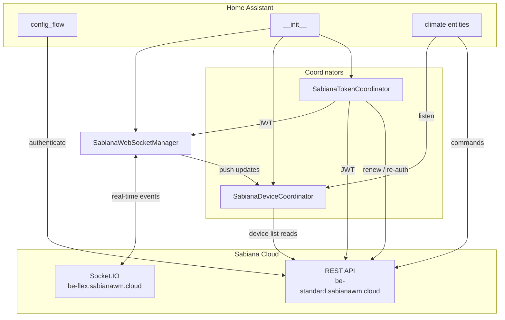

# Sabiana HVAC Integration — Technical Architecture

## Purpose and Scope

This document explains how the `sabiana_hvac` custom integration works internally, how it integrates with Home Assistant, and which architectural decisions shape its current behavior.

The integration provides cloud-based control of compatible Sabiana HVAC units by:

- authenticating against Sabiana cloud REST APIs,
- discovering available devices,
- maintaining real-time state through a Sabiana Socket.IO WebSocket,
- reading the device list via REST only when the official app does (setup, reconnections, server refresh requests); while the WebSocket is down devices are unavailable, as in the app,
- exposing each device as a Home Assistant `climate` entity,
- translating Home Assistant climate actions into Sabiana command payloads.

State is synchronized from the cloud (WebSocket + REST), with a short optimistic window after local commands to keep the UI responsive while the device processes changes.

---

## High-Level System Architecture

At runtime, the integration is composed of eight core modules:

| Module | Responsibility |
|--------|----------------|
| `config_flow.py` | Interactive setup from the Home Assistant UI |
| `__init__.py` | Config entry lifecycle, runtime wiring, platform forwarding |
| `api.py` | HTTP client, authentication, device list parsing, command dispatch |
| `protocol.py` | `lastData` decoding, ported from the official app's fancoil model |
| `coordinator.py` | JWT lifecycle (`SabianaTokenCoordinator`) and device state (`SabianaDeviceCoordinator`) |
| `websocket.py` | Socket.IO connection for real-time device updates |
| `climate.py` | Climate entities, command encoding, coordinator listeners |
| `const.py` | Constants, endpoints, mode mappings, reconnection delays |

Supporting modules:

- `models.py` — `JWT`, `SabianaDevice` (device record), `SabianaDeviceList` and `SabianaDeviceState` (decoded `lastData`)
- `manifest.json` — integration registration and dependencies



---

## Integration with Home Assistant

### Manifest and Registration

The integration is registered through `custom_components/sabiana_hvac/manifest.json`:

- `domain`: `sabiana_hvac`
- `config_flow`: `true`
- `iot_class`: `cloud_push` (WebSocket push)
- `requirements`: `httpx`, `voluptuous`, `httpx-retries`, `python-socketio[asyncio_client]`

Only the `climate` platform is exposed (`PLATFORMS = [Platform.CLIMATE]`).

### Config Entry Lifecycle

Home Assistant integration lifecycle is implemented in `__init__.py`:

1. **`async_setup_entry`**
   - validates JWT tokens in the `ConfigEntry`,
   - creates a reusable HTTP session with retry support,
   - instantiates `SabianaTokenCoordinator` and runs the first refresh,
   - creates `SabianaWebSocketManager` and `SabianaDeviceCoordinator`,
   - reads the device list (`getDeviceForUserV2`) through the device coordinator's first refresh; on failure HA retries the setup (`ConfigEntryNotReady`),
   - then attempts a non-blocking WebSocket connect (same order as the app),
   - stores runtime objects in `hass.data[DOMAIN][entry_id]`,
   - forwards setup to the `climate` platform.

2. **`async_unload_entry`**
   - unloads climate platform entities,
   - disconnects the WebSocket manager,
   - shuts down the device coordinator (unregisters callbacks),
   - removes cached runtime objects from `hass.data`.

The runtime data store for each entry contains:

| Key | Type | Purpose |
|-----|------|---------|
| `session` | `httpx.AsyncClient` | Shared HTTP client with retries |
| `token_coordinator` | `SabianaTokenCoordinator` | JWT refresh and persistence |
| `device_coordinator` | `SabianaDeviceCoordinator` | Device records (`dict[str, SabianaDevice]`) |
| `websocket_manager` | `SabianaWebSocketManager` | Real-time Socket.IO connection |
| `devices` | `list[SabianaDevice]` | Devices found at setup (climate entities are created from it) |

---

## Configuration Flow (UI Setup)

The user onboarding flow in `config_flow.py` follows Home Assistant's standard `ConfigFlow` model:

1. Prompt user for `email` and `password`.
2. Call `api.async_authenticate(...)`.
3. On success:
   - set unique ID to lowercase email (`async_set_unique_id(email.lower())`),
   - prevent duplicate setup for the same account,
   - persist credentials and JWTs in the config entry.
4. On failure:
   - map connection/auth/API errors to localized HA form error keys.

### Data Persisted in ConfigEntry

| Field | Description |
|-------|-------------|
| `email`, `password` | Account credentials for re-authentication |
| `short_jwt`, `short_jwt_expire_at` | Short-lived API token and expiry (unix timestamp) |
| `long_jwt`, `long_jwt_expire_at` | Long-lived renewal token and expiry |

This allows startup without immediate re-login while enabling long-term automatic token maintenance.

---

## API Layer Design

The `api.py` module centralizes all REST communication with Sabiana cloud endpoints and enforces strict response validation.

### Endpoints Used

| Method | Path | Purpose |
|--------|------|---------|
| `POST` | `/users/newLogin` | Authenticate; obtain short/long JWTs |
| `GET` | `/devices/getDeviceForUserV2` | List devices, their `lastData` state and `lastFw` |
| `POST` | `/renewJwt` | Renew short JWT using long JWT |
| `POST` | `/devices/cmd` | Send command payload to a device |

Base URL: `https://be-standard.sabianawm.cloud` (`const.BASE_URL`).

### HTTP Client and Retry

`create_session_client(...)` creates an HA-managed `httpx.AsyncClient` and applies `RetryTransport`:

- total retries: 3
- backoff factor: 0.5
- timeout: 5.0 seconds

### Error Model

Custom exception hierarchy:

- `SabianaApiClientError` (base)
- `SabianaApiAuthError` (authentication-specific)

Response validation runs in two stages:

1. **HTTP status** — `401` → `SabianaApiAuthError`; other `>= 400` → `SabianaApiClientError`
2. **API JSON status** — `99` or `103` → `SabianaApiAuthError`; any non-zero → `SabianaApiClientError`

### JWT Expiry Parsing

JWT expiration is derived from the token payload:

- decode JWT payload (`base64url`),
- extract `exp` claim,
- convert to timezone-aware UTC `datetime`.

Malformed tokens or missing `exp` fail setup with `SabianaApiClientError`.

### Device List (`getDeviceForUserV2`)

`async_get_devices()` returns a `SabianaDeviceList`, parsed by `parse_device_list()`:

- `devices` — one `SabianaDevice` per entry, keyed and sorted by `idDevice` like the app. Each record keeps the server fields (`deviceName`, falling back to `idDevice`; `deviceStateModelType`; group and sharing flags; `connectionUp`; `deviceStateFw`; `deviceWiFiRSSI`; `fwUpdateRequest`; `deviceTimeZone`; `lastData`) plus the decoded `state` and `data_valid`.
- `last_fw` — latest firmware version per model type (`lastFw`).
- `rotated_token` — the envelope's `token`: as in the app, a successful response may carry a new long JWT, which the token coordinator stores.

A device is `controllable` (and its climate entity available) only when the cloud does not report it offline (`connectionUp`) and its `lastData` is valid, as the app requires. A missing `connectionUp` field is treated as online. RVU heat recovery units (`deviceStateModelType: "rvu"`) are parsed but not decoded, and get no climate entity.

### Device State Decoding (`lastData`)

`protocol.py` ports the official app's fancoil model (classes `he`, `G` and `E` of the app bundle). The frame is a string of 16-bit words, numbered from 1 as in the app; the server sends lowercase hex. Main words:

| Word | Content |
|------|---------|
| 1 | Controller model (uppercased): selects the profile (name, fan scale, timers, night mode, flap) |
| 2, 15, 16 | Firmware POW, ESP (T-MB on TMB), DISP |
| 3 | Mode (low byte) and fan (high byte) |
| 4 | Status flags: on, thermostat request, auto available, night, remote on/off, resistance, timer, Sabianet, open window |
| 5 | Flap: low byte 1 = present, high byte = position |
| 6–9 | T1 and the summer / winter / auto setpoints (signed, ×10) |
| 10–11 | Setpoint limits in cooling and heating |
| 13 | Alarms (filtered by model) |
| 14 | Device clock |
| 17 | DIP switches |

Notable rules, all from the app:

- **Validity** — missing or short frames, `"999999"` and frames starting with 16 zeros are DATA-ERROR: the device is not controllable.
- **Profile** — `deviceStateModelType: "tmb"` selects the TMB branch; for other fancoils only word 1 matters.
- **On/off** — bit 0 of word 4, forced off when the remote on/off contact is active (bit 8, inverted polarity on `500B`/`500C`).
- **Target temperature and limits** — per mode; none in fan only; winter setpoint in mode 2 on the Meltemi `5029`.
- **Fan** — `0` reads as `1`; continuous models convert legacy `1`/`2`/`3` to `20`/`60`/`110`; `500D`/`500E` switch to the continuous scale when the fan is ≥ 20. `fan_mode` maps the levels to low/medium/high/auto for the climate entity.
- **Flap** — read only on models with a flap (TMB, `500A`, `500D`, `500E`).
- **HVAC action** — from the app's mode icon: off, fan, idle without thermostat request, otherwise cooling or heating (in auto, T1 compared with the auto setpoint).

### Command Encoding

`protocol.FancoilCommand` reproduces the app's `doSendCmd`. Every command is the full block of 5 registers sent with `POST /devices/cmd`, `start: 2304`, `restart: false`, uppercase hex:

| Register | Content |
|----------|---------|
| 2304 | on: `mode + 256·fan`; off: `4 + 256·fan` |
| 2305 | setpoint × 10, rounded to 0.5 °C; `0` in fan only |
| 2306 | flap present: `1 + 256·position`; no flap: `FF00` |
| 2307 | `FFFF` (the clock is only written over Bluetooth) |
| 2308 | bit 0 timer, bit 1 night mode |

The command is built from the current state (`FancoilCommand.from_state`) with one value changed, and the timer bit is read again from the unit when the command is actually sent (as `getOptionsForCmd` in the app): Home Assistant never switches the timer off. Fan values follow the unit's scale (`protocol.fan_scale`): `3A` (low/medium/high/auto = 1/2/3/4), `2` on the Meltemi (low/high), `10A` and `19A` (auto and levels `"1"`…`"10"`, with half levels on 19A; value = 10·level + 10).

The integration only uses this route and this block: group commands (`devices/cmds`) and the options-only block (`start: 2308`) are not used.

---

## Token Lifecycle Management

`SabianaTokenCoordinator` runs on a **60-second** update interval.

### Refresh Algorithm

At each cycle (with a **5-minute safety margin** before expiry):

1. If **long JWT** is expired or expiring soon → full re-authentication with stored credentials.
2. Else if **short JWT** is expired or expiring soon → `renewJwt`; on auth failure, fallback to full re-auth.
3. Else → keep current token.

On success, tokens are persisted via `async_update_entry(...)`.

### Force Renew

`async_force_renew()` bypasses expiry checks when the server rejects a locally valid token (e.g. revocation). Climate command handlers call this on `SabianaApiAuthError` and retry once.

### Failure Behavior

API and network errors become `UpdateFailed`, Home Assistant's standard coordinator failure signal.

---

## WebSocket Layer

`SabianaWebSocketManager` (`websocket.py`) connects to `https://be-flex.sabianawm.cloud` using `python-socketio` with JWT auth.

### Connection Behavior

- Connects after the first device list read, like the app; the handshake carries the short JWT in `auth.token`.
- Refreshes the JWT via `token_coordinator.async_request_refresh` before each connect (important for reconnects; the app updates `socket.auth.token` after each renewal).
- Uses `aiohttp.ThreadedResolver()` to avoid broken `aiodns`/`pycares` combinations in some HA environments.
- Disables Socket.IO built-in reconnection; implements **exponential backoff**: 5 s initial, 60 s max, randomized by ±50 % like the app, so the backend is never flooded (the app retries every 1–5 s). The delay goes back to 5 s only after a connection lasted at least 60 s, so a server that accepts and drops at once is not hammered. A failed first connection is retried the same way.
- On every reconnection after the first, re-reads the device list (app: `forceUpdateAllDevice` on `connect`), since events sent while the channel was down are lost.
- Failed attempts read nothing via REST: while the channel is down the cloud is offline and devices are unavailable (app: `isCloudOnLine`).
- Logs each disconnection with its reason, the connection duration and the expiry of the handshake JWT, to find the cause of the periodic drops.

### Socket.IO Events

| Event | Payload | Action |
|-------|---------|--------|
| `data` | `{ device, data: hex }` | Raw frame → device coordinator, which decodes it and marks the device online |
| `connEvents` | `{ device, data: CONNECT\|DISCONNECT }` | Device coordinator updates `connection_up` |
| `status` | `{ device, deviceStateFw, deviceWiFiRSSI }` | Device coordinator updates firmware and WiFi signal |
| `appMsg` | `{ msg: "refresh" }` | Re-read the device list |
| `error` | error payload | Logged |

### Callback Registration

The manager exposes unregisterable callbacks for:

- device data, connection and status events,
- connection status changes (used for the entities' availability),
- server refresh requests.

---

## Device State Coordinator

`SabianaDeviceCoordinator` owns the device records (`dict[str, SabianaDevice]`) like the app's device list.

### Update Sources

1. **WebSocket** — `data`, `connEvents` and `status` events replace a single device record and call `async_set_updated_data`; an unchanged frame on an online device is ignored.
2. **REST read** — `GET /devices/getDeviceForUserV2` replaces the whole list, only when the app reads it: at setup, after every reconnection of the socket (not the first connection) and on `appMsg: refresh`. Listeners are not notified when nothing changed (`always_update=False`). A malformed body fails the read and keeps the previous list.

When a REST read finds devices added to or removed from the account, the coordinator schedules a reload of the config entry so entities follow the change.

### No Polling

There is no periodic read (`update_interval=None`), as in the app. When the WebSocket goes up or down the coordinator notifies the entities, which are unavailable and refuse commands while it is down. Each read refreshes the JWT via `token_coordinator` before calling the API.

---

## Climate Entity Model

`SabianaHvacClimateEntity` maps each fancoil `SabianaDevice` to one climate entity (RVU units are skipped). The entity takes the device name and registers a device with the model, model code and firmware read from the device list.

### Entity Capabilities

Capabilities are read from the unit's profile and state at every update:

- HVAC modes: `off`, `cool` (not on the Meltemi), `heat`, `auto` (only when bit 2 of word 4 is set; "max heating" on the Meltemi), `fan_only`. A CFF ECO in reduced mode (`5021` without DIP) only offers off and its current mode.
- HVAC action (`off`, `fan`, `idle`, `cooling`, `heating`), from the app's mode icon logic.
- Target temperature (0.5 °C step) with the limits of the current mode; none in fan only or in reduced mode.
- Fan modes from the unit's scale (see Command Encoding).
- Swing modes only on units with a flap: `Stop swing`, `Horizontal`, `45 Degrees`, `Vertical`, `Swing` (positions 0–4); `Stop swing` and `Swing` on TMB units.
- Preset `sleep` (night mode) only on models that have it.
- Availability: unavailable while the WebSocket is down, when the cloud reports the device offline, or when its `lastData` is invalid (app: `isCloudOnLine`, `connectionUp`, `isDataValid`).

### Command Execution Pipeline

1. A service call builds a `FancoilCommand` from the shown values; nothing is sent if nothing changes.
2. Checks from the app: turning on (or choosing a mode) is refused while the remote on/off contact is active; while the unit is off only on/off and the flap can be changed (setpoint, fan and night mode need it on, unless the same call turns it on); commands are refused while the WebSocket is down or the unit is offline or its data is not valid.
3. The command becomes *pending* and is shown at once.
4. Sending is throttled like the app: the first change goes out immediately, later changes within 1.5 s are merged into one trailing command with the latest values.
5. `POST /devices/cmd` with a fresh token; on `SabianaApiAuthError` → `async_force_renew()` and one retry. A rotated long JWT in the response is stored. A failed send clears the pending command and raises `HomeAssistantError`.

### Confirmation

`status: 0` only means the cloud accepted the command. The pending values stay on screen until a frame shows them applied (on, mode, fan, setpoint, night mode and flap). If none arrives within 5 seconds, the entity shows the device state again and logs a warning. (The app waits 3.9 s for any `data` event.)

---

## Runtime Data Flow

### Inbound (cloud → Home Assistant)

```
Sabiana cloud
  ├─ WebSocket "data" / "connEvents" / "status" event
  │     └─ SabianaDeviceCoordinator: decode_device_data → data[device_id]
  │           └─ climate entity listener → async_write_ha_state
  └─ REST read (getDeviceForUserV2: setup, reconnection, appMsg refresh)
        └─ parse_device_list → SabianaDeviceCoordinator.data (whole list)
```

### Outbound (Home Assistant → cloud)

```
User / automation
  └─ climate service call
        └─ FancoilCommand (from state, one change) → pending, shown at once
              └─ throttle 1.5 s → POST /devices/cmd (start 2304)
                    └─ matching "data" frame → confirmed
                       or 5 s timeout → device state shown again
```

---

## Reliability and Observability

### Reliability Controls

- centralized response validation in the API layer,
- explicit auth vs generic error separation,
- HTTP retry transport for transient failures,
- JWT refresh with 5-minute safety margin and force-renew on server rejection,
- WebSocket reconnect with exponential backoff,
- device list re-read after every WebSocket reconnection,
- pending commands confirmed by matching frames, with a timeout.

### Logging

Structured logging at `info`, `debug`, `warning`, and `exception` levels across setup, token lifecycle, WebSocket events, decoding, and command dispatch.

---

## Security Considerations

- Credentials are stored in Home Assistant config entry storage and used only to authenticate against Sabiana cloud.
- Token expiry is validated from JWT `exp` claims.
- Authorization headers: short JWT in `auth`; long JWT in `renewauth` for renewal.
- No custom cryptography; the integration consumes Sabiana-issued JWTs and API contracts.

---

## Testing Strategy

Unit tests in `tests/`:

| File | Coverage |
|------|----------|
| `test_config_flow.py` | Setup flow, error mapping |
| `test_api.py` | Response validation, JWT parsing, device list parsing, endpoints |
| `test_protocol.py` | `lastData` decoding and command encoding against the app's rules and the protocol doc examples |
| `test_coordinator.py` | Token refresh/re-auth/rotation, device list reads, WebSocket events |
| `test_climate.py` | Entity capabilities, availability, commands, confirmation, throttling |
| `test_websocket.py` | Socket.IO handshake, reconnection and re-read, event parsing |

Run tests from the dev container:

```bash
pytest tests/
```

---

## Current Limitations

1. **Cloud dependency** — availability depends on Sabiana REST and WebSocket infrastructure.
2. **Unofficial API** — reverse-engineered from the mobile app; Sabiana may change contracts without notice.
3. **Model support** — tested primarily on **Sabiana Carisma Fly**. Decoding follows the official app for every fancoil profile; RVU heat recovery units are not supported yet.
4. **Beta status** — functional but may have edge cases in decoding or reconnect scenarios.

---

## File-Level Reference Map

| File | Role |
|------|------|
| `manifest.json` | Domain registration, `iot_class`, dependencies |
| `config_flow.py` | UI setup and credential/token persistence |
| `__init__.py` | Setup/unload orchestration, runtime `hass.data` |
| `api.py` | REST client, validation, device list parsing, commands |
| `protocol.py` | `lastData` decoder (port of the app's fancoil model) |
| `coordinator.py` | `SabianaTokenCoordinator`, `SabianaDeviceCoordinator` |
| `websocket.py` | `SabianaWebSocketManager`, Socket.IO event handling |
| `climate.py` | Climate entities, command encoding, state sync |
| `const.py` | URLs, intervals, mode maps, error keys |
| `models.py` | `JWT`, `SabianaDevice`, `SabianaDeviceList`, `SabianaDeviceState` |
